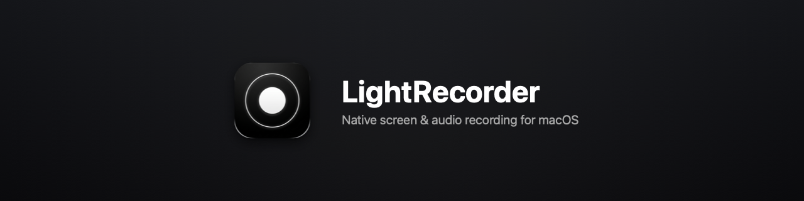

# LightRecorder



A lightweight macOS menu bar app for recording your screen and system audio. Built with SwiftUI, ScreenCaptureKit, and AVFoundation. Completely offline with no third-party audio drivers required.

## Features

- **Capture modes**: Full screen, custom drag-selected area, or specific window/app.
- **System audio without drivers**: Captures internal audio directly via ScreenCaptureKit—no BlackHole, Soundflower, or kernel extensions.
- **Separate microphone track**: Records microphone input to an independent track for easier editing.
- **Hardware-accelerated encoding**: Supports H.264 and HEVC (H.265) in `.mp4` and `.mov` containers.
- **Crash resilience**: Uses fragmented MP4/MOV (`fMP4`/`fMOV`) so recordings remain playable up to the last fragment if the system shuts down or crashes.
- **Pre-recording countdown**: Minimalist countdown overlay with Esc to cancel.
- **Privacy controls**: Options to hide cursor, wallpaper, Dock, and desktop icons during recording.
- **Automation**: Global hotkeys via [KeyboardShortcuts](https://github.com/sindresorhus/KeyboardShortcuts) and a `lightrecorder://` URL scheme for scripts, Raycast, and Shortcuts.

## Requirements

- macOS 13.0 (Ventura) or later
- Universal binary: Apple Silicon and Intel

## Installation

Download the latest `.dmg` from [Releases](https://github.com/uditrajput03/lightrecorder/releases/latest) and move `LightRecorder.app` to your `/Applications` folder.

On first launch, macOS will prompt for **Screen Recording** permission (and **Microphone** permission if mic recording is enabled).

## Shortcuts & Automation

### Default Shortcuts

| Action | Shortcut |
| :--- | :--- |
| Start / Stop Recording | `⌘ R` |
| Full Screen Mode | `⌘ 1` |
| Select Area | `⌘ 2` |
| Select Window / App | `⌘ 3` |
| Open Settings | `⌘ ,` |
| Cancel Countdown / Area Selection | `Esc` |

### URL Scheme

Control recording from terminal scripts, Raycast, Alfred, or Apple Shortcuts:

```bash
# Start or stop recording
open "lightrecorder://toggle"

# Stop recording and copy output file to clipboard
open "lightrecorder://toggle-copy"

# Open the recordings directory in Finder
open "lightrecorder://open-recordings"
```

## Building from Source

### Prerequisites

- Xcode 14.3+ / Command Line Tools
- macOS 13.3+ SDK

### Build

```bash
# Clone
git clone https://github.com/uditrajput03/lightrecorder.git
cd lightrecorder

# Build release application
xcodebuild -project LightRecorder.xcodeproj \
           -scheme LightRecorder \
           -configuration Release \
           build

# Run tests
xcodebuild -project LightRecorder.xcodeproj \
           -scheme LightRecorder \
           -configuration Debug \
           test
```

## License

MIT
