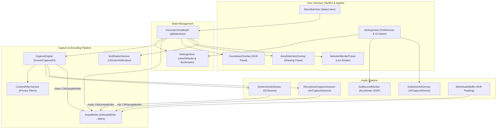

# LightRecorder

<div align="center">


[](https://uditrajput03.github.io/lightrecorder)
[](LICENSE)
[](https://www.apple.com/macos/)
[](https://swift.org)
[](#running-tests)

**A blazing fast, private, native macOS menu bar screen and audio recorder.**  
Built entirely with SwiftUI, ScreenCaptureKit, and AVFoundation. Zero telemetry, zero external audio drivers, and 100% offline.

[Features](#features) • [Installation](#installation) • [Capture Modes](#capture-modes) • [Audio & Crash Resilience](#audio--crash-resilience) • [Automation](#automation--url-scheme) • [Architecture](#architecture) • [Building](#building-from-source)

</div>

---

## Overview

LightRecorder is an open-source macOS utility designed for developers, creators, and professionals who need high-performance screen recording without the bloat. Unlike traditional tools, LightRecorder:

- **Requires no virtual audio drivers** (no BlackHole, Soundflower, or system extensions needed).
- **Runs entirely offline** with zero analytics, tracking, or network requests.
- **Features crash-resilient fragmented recording** so your footage is never lost to system panics or power outages.
- **Lives unobtrusively in the menu bar** with global keyboard shortcuts and deep macOS integration.

---

## Features

### 🖥️ Video & Capture Control
- **Three Capture Modes**: Full Screen, interactive custom Drag-Selection Area, or isolated Window / App capture.
- **Hardware-Accelerated Encoders**: Apple Silicon and Intel hardware-accelerated HEVC (H.265) and H.264 encoding.
- **Container Formats**: Modern `.mp4` and flexible `.mov` containers.
- **Frame Rate Selection**: Smooth 60 fps, standard 30 fps, cinematic 24 fps, or native refresh rate capture.
- **Resolution Options**: Pixel-perfect native Retina resolution or standard 1x logical resolution.
- **Quality Bitrate Presets**: High, Medium, and Low bitrate tiers optimized with resolution-aware bits-per-pixel multipliers.
- **Countdown Timer**: Configurable pre-recording HUD (3s, 5s, 10s, or Off) centered on your capture target with quick Escape cancel.

### 🎙️ Audio & Microphone Management
- **Internal System Audio**: Direct loopback audio capture via ScreenCaptureKit without extra kernel extensions or third-party audio drivers.
- **Isolated Microphone Track**: Independent microphone capture into a secondary audio track for effortless post-production mixing.
- **Microphone Device Picker**: Choose between Built-in Mics, AirPods, USB interfaces, and external capture devices with instant hot-plug detection.
- **Pre-Flight Live VU Meter**: Real-time dB level meter with dynamic peak-hold and warning indicators in Settings to verify mic levels before recording.
- **Audio Drift & Desync Prevention**: Sub-millisecond PTS alignment and automatic silence padding for dropped buffers or delayed inputs.

### 🛡️ Crash Resilience & Reliability
- **Fragmented MP4 / MOV (`fMP4` / `fMOV`)**: Periodic container fragmenting writes valid movie chunks every few seconds. If your Mac battery dies or the system reboots, the video file remains fully playable up to the last recorded fragment without a corrupted `moov` atom header.
- **Monotonic Timestamp Enforcement**: Drops duplicate or out-of-order capture frames caused by system load or display refresh jitter.

### 🎨 Content Privacy & Customization
- **Clean Recording Surfaces**: Toggle the visibility of the mouse cursor, desktop wallpaper, Dock, macOS menu bar, and LightRecorder itself.
- **Window Shadow Toggling**: Record clean window rectangles without oversized drop-shadow borders.

### ⚡ Shortcuts & Automation
- **Global Hotkeys**: Configurable system-wide shortcuts for starting/stopping, area selection, and content picking via [KeyboardShortcuts](https://github.com/sindresorhus/KeyboardShortcuts).
- **Clipboard Integration**: Automatically copy the exported video file directly to your clipboard upon finishing.
- **URL Scheme Automation**: Control recording state headlessly via `lightrecorder://` URLs in Raycast, Shortcuts, Alfred, or terminal scripts.

---

## Installation

### Download Release
1. Grab the latest `.dmg` or zip archive from [GitHub Releases](https://github.com/uditrajput03/lightrecorder/releases/latest).
2. Open the disk image and drag `LightRecorder.app` into `/Applications`.
3. Launch the app and grant the necessary macOS permissions.

### System Requirements
- **OS**: macOS 13.0 (Ventura) or later
- **Architecture**: Universal binary (Apple Silicon M1/M2/M3/M4 & Intel x86_64)
- **Permissions**:
  - **Screen Recording**: Required by macOS ScreenCaptureKit.
  - **Microphone**: Required only if recording voice/microphone audio.

---

## Capture Modes

| Mode | Shortcut | Description |
| :--- | :---: | :--- |
| **Full Screen** | `⌘ 1` | Records the entire active display at native Retina or 1x resolution. Multi-display setups are supported. |
| **Select Area** | `⌘ 2` | Interactive screen overlay with draggable handles, dimension display, and even-pixel boundary snapping for encoder compliance. |
| **Window / App** | `⌘ 3` | Captures a specific application window or process canvas cleanly using ScreenCaptureKit (macOS 14+ picker integration). |

---

## Audio & Crash Resilience

### Real-Time Pre-Flight VU Meter
Before you record a presentation or tutorial, open **Settings $\rightarrow$ Audio**:
- Live decibel metering powered by Apple's **Accelerate `vDSP`** framework.
- Visual peak-hold indicators show clipping thresholds (Green $\rightarrow$ Yellow $\rightarrow$ Red).
- Hardware selector instantly switches between connected audio inputs.

### Fragmented Movie Recording
Traditional MP4/MOV files store index metadata (`moov` atom) at the end of the file. If an app crashes during recording, the entire file is rendered unreadable.

LightRecorder solves this with **Fragmented MP4 / MOV**:
- Writes discrete movie fragments (`moof` + `mdat`) every 5 seconds.
- Guarantees that any unexpected termination preserves your recorded footage up to that moment.
- Plays smoothly in QuickTime Player, VLC, IINA, and imports cleanly into Final Cut Pro and Premiere.

---

## Automation & URL Scheme

Control LightRecorder programmatically from shell scripts, Raycast extensions, Alfred workflows, or Apple Shortcuts:

| URL Endpoint | Action |
| :--- | :--- |
| `lightrecorder://toggle` | Starts recording (with countdown if configured) or stops an active recording session. |
| `lightrecorder://toggle-copy` | Starts or stops recording, copying the saved video file path to the macOS clipboard upon completion. |
| `lightrecorder://open-recordings` | Opens the current output folder in Finder, automatically resolving security-scoped bookmarks. |

### Shell Scripting & Terminal

```bash
# Start or stop recording
open "lightrecorder://toggle"

# Stop recording and automatically copy output path to clipboard
open "lightrecorder://toggle-copy"

# Reveal the output directory in Finder
open "lightrecorder://open-recordings"
```

---

## Architecture

LightRecorder is designed around clean MVVM and actor-isolated service boundaries:



### Key Components

- **`CaptureEngine`**: Orchestrates `SCStream`, manages display and window streams, handles content filters, and pipes buffers into dedicated high-priority queues.
- **`AssetWriter`**: Multi-track AVAssetWriter pipeline with fragmented container support, monotonic timestamp rebasing, and silence gap insertion.
- **`AudioLevelMonitor`**: Session-queue isolated AVCaptureSession calculating accurate RMS and peak audio power using `vDSP_measqv` and `vDSP_maxv`.
- **`AreaSelectionOverlay`**: Multi-display borderless transparent panel with coordinate flipping between AppKit and ScreenCaptureKit spaces.
- **`SettingsStore`**: Persistent user preferences with security-scoped bookmark support for sandboxed folder access.

---

## Building from Source

### Prerequisites
- macOS 13.3 SDK or later
- Xcode 14.3.1+ (or Command Line Tools)
- Git

### Build Commands

```bash
# 1. Clone the repository
git clone https://github.com/uditrajput03/lightrecorder.git
cd lightrecorder

# 2. Build Release App Bundle
xcodebuild -project LightRecorder.xcodeproj \
           -scheme LightRecorder \
           -configuration Release \
           build

# 3. Locate compiled application
# Found under: DerivedData/LightRecorder/Build/Products/Release/LightRecorder.app
```

### Running Tests

The test suite validates frame rate scaling, container compatibility, audio padding, silent sample generation, and settings persistence:

```bash
xcodebuild -project LightRecorder.xcodeproj \
           -scheme LightRecorder \
           -configuration Debug \
           test
```

---

## Contributing

Contributions, bug reports, and suggestions are welcome!
1. Fork the repository.
2. Create a feature branch (`git checkout -b feature/amazing-feature`).
3. Commit your changes (`git commit -m 'Add amazing feature'`).
4. Push to the branch (`git push origin feature/amazing-feature`).
5. Open a Pull Request.

Please check [CONTRIBUTING.md](CONTRIBUTING.md) for code style guidelines.

---

## License

LightRecorder is released under the **MIT License**. See [LICENSE](LICENSE) for full details.
