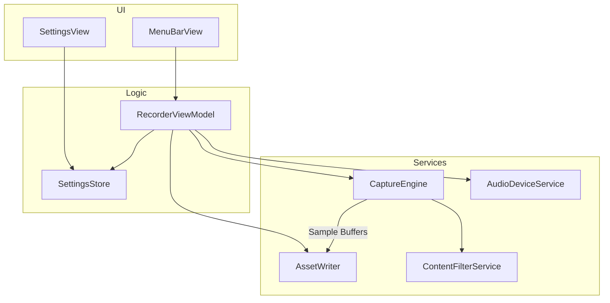

# LightRecorder

[](https://uditrajput03.github.io/lightrecorder)
[](LICENSE)

LightRecorder is an open-source macOS menu bar screen recording application built with SwiftUI and ScreenCaptureKit. It records screen video and audio locally without background telemetry, third-party audio drivers, or account requirements.

## Features

- **Capture Modes**: Full screen, custom drag-selected area, or single window/application capture via macOS Content Sharing Picker.
- **Video Encoders**: HEVC (H.265) and H.264 video compression in `.mov` or `.mp4` containers.
- **Bitrate Presets**: High, Medium, and Low quality tiers with resolution-aware bits-per-pixel targets.
- **Frame Rates**: 60 fps, 30 fps, 24 fps, or native display refresh rate.
- **Resolution Control**: Native Retina pixel resolution or 1x logical resolution capture.
- **Audio Capture**: Simultaneous recording of system audio and microphone inputs into separate audio tracks (AAC or uncompressed PCM in `.mov`).
- **Content Filtering**: Exclude cursor, desktop wallpaper, menu bar, Dock, or LightRecorder itself from recordings. Window shadows can be toggled per capture.
- **Menu Bar Control**: Status item displaying an active recording timer with quick toggles for sources, inputs, and destination folder.
- **Global Shortcuts**: System-wide configurable hotkeys for toggling recording, selecting an area, and opening the window picker.
- **Local Storage**: Files save to `~/Movies/LightRecorder` by default or a user-selected security-scoped folder.

## Requirements

- macOS 13.0 (Ventura) or later
- Screen Recording permissions granted in System Settings
- Microphone permissions (optional, for microphone recording)

## Installation

### Releases

Download the latest `.dmg` from the [GitHub Releases](https://github.com/uditrajput03/lightrecorder/releases/latest) page and move `LightRecorder.app` into `/Applications`.

### Homebrew

```bash
brew install lightrecorder
```

## Capture Modes

| Mode | Description |
| --- | --- |
| **Full Screen** | Records an entire display at native or scaled resolution. |
| **Select Area** | Interactive drag-selection overlay with coordinate snapping, resize handles, and dimension indicators. |
| **Window / App** | Targets an individual application window or process canvas through ScreenCaptureKit. |

## Automation

LightRecorder handles the `lightrecorder://` URL scheme for integration with Raycast, Shortcuts, Alfred, or shell scripts.

| URL | Action |
| --- | --- |
| `lightrecorder://toggle` | Toggles recording state using the currently selected capture mode. |
| `lightrecorder://toggle-copy` | Toggles recording state and copies the finalized video file path to the clipboard upon completion. |
| `lightrecorder://open-recordings` | Opens the configured output recordings folder in Finder. |

### CLI Example

```bash
# Start or stop recording
open "lightrecorder://toggle"

# Stop recording and copy the file to clipboard
open "lightrecorder://toggle-copy"

# Open the recordings folder
open "lightrecorder://open-recordings"
```

## Building from Source

### Prerequisites

- Xcode 14.3.1 or later
- Command Line Tools (`xcode-select --install`)

### Build Commands

```bash
# Clone the repository
git clone https://github.com/uditrajput03/lightrecorder.git
cd lightrecorder

# Open in Xcode
open LightRecorder.xcodeproj
```

To build or run tests from the command line:

```bash
# Build release binary
xcodebuild -project LightRecorder.xcodeproj -scheme LightRecorder -configuration Release build

# Run test suite
xcodebuild -project LightRecorder.xcodeproj -scheme LightRecorder -configuration Debug test
```

## Architecture

LightRecorder is structured as a Model-View-ViewModel (MVVM) application:



## Contributing

See [CONTRIBUTING.md](CONTRIBUTING.md) for details on filing issues, discussions, and submitting pull requests.

## License

MIT License. See [LICENSE](LICENSE) for details.
